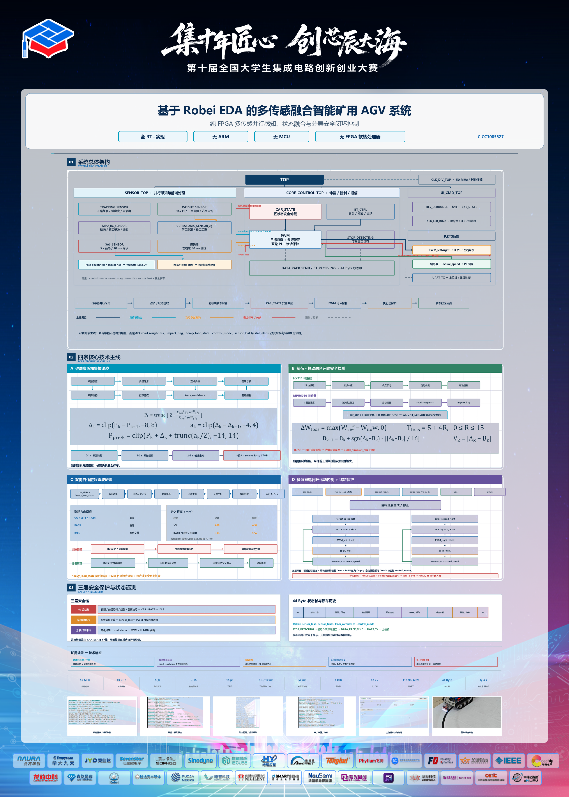

煤矿运输的麻烦在于，一辆车要同时盯好几件事：路径要跟住，前后不能撞，载荷不能丢也不能超，路面颠簸不能误判成掉货，巷道里还可能有瓦斯。用 MCU 做，这些事只能靠轮询和中断排队，传感器一多，谁先谁后就变成调度问题；而且异常同时出现时，"先处理哪个"要在代码里写死。

这个作品换了个做法：整辆车只有 FPGA。瓦斯、双向超声波、HX711 称重、八路灰度循迹、MPU6050 航向与振动、编码器测速各自是独立的 RTL 模块，在同一个 50 MHz 时钟下并行运行，谁都不用等谁。安全信号能不能压过运动命令，由状态仲裁模块说了算，不靠程序执行顺序。

## 结构

顶层 `TOP` 只做连接，下面四个子系统：

| 子模块 | 职责 |
| --- | --- |
| `SENSOR_TOP` | 五路传感器采集：称重、灰度、瓦斯、双通道超声波、MPU6050 |
| `CORE_CONTROL_TOP` | `CAR_STATE` 状态仲裁、`PWM` 闭环调速、蓝牙收发 |
| `UI_CMD_TOP` | 按键消抖、状态显示、LED 指示、蜂鸣器 |
| `CLK_DIV_TOP` | 统一复位与多档时钟使能 |

全部模块挂 50 MHz 主时钟，低频逻辑用时钟使能驱动，不在 FPGA 内部大量派生新时钟。

## 四个我自己比较满意的设计

**循迹带健康度。** 八路灰度不是直接算偏差就完事。输入先过五点多数滤波，每个通道还单独做健康度诊断和故障通道处理，再算轨迹位置与置信度（0–15）。轨迹质量下降或短时断轨时，系统按 `NORMAL → DEGRADED → RECOVERY → STOP` 分级降速直到停车，而不是一断线就急停。

**载荷和振动是耦合的。** 只挂 HX711 做掉重检测会一直误报：过个坎，称重数据就跳。所以 MPU6050 在输出航向误差的同时提取 Z 轴振动，给出路面粗糙度和强冲击状态送进称重模块；车辆一运动就冻结载荷参考，用粗糙度动态调整掉重判据。反过来，称重模块输出的重载状态又送进 `PWM` 和超声波模块，让重载时目标速度更低、避障距离更大。

**避障的进和出用不同阈值。** 前后两个超声波通道，距离数据先做三点中值和八点平均。障碍进入和解除用两套阈值，安全解除还要连续确认，避免车在临界距离上反复启停。

**安全分两层。** 瓦斯、障碍、超载、载荷异常属于车辆状态级事件，`CAR_STATE` 强制切 `IDLE`；轨迹持续丢失由 `PWM` 自己把循迹目标速度清零；电机堵转 `stall_alarm` 直接关掉 PWM 和 H 桥方向输出。上层管状态，下层管执行，任何一层失效另一层还在。换向保护留了约 0.5 s。

## 实测

| 项目 | 结果 |
| --- | --- |
| HX711 称重 | 空载与 1000 g 标准砝码均正常，开机自动去皮 |
| MQ-4 瓦斯 | 打火机模拟超限，蜂鸣器鸣响，产生锁存报警并强制停车 |
| JSN-SR04T 避障 | 盲区在 25 cm 以内 / 180 cm 以外；`GO → IDLE` 后停车距离约 15 cm |
| 八路灰度 | 直走、圆弧弯道、丢线保护均按预期动作 |

## 没做完的部分

写在报告里也放在这里，因为这部分比成绩有用：

- 复杂工况没测。粉尘、水雾、坡道、持续强振动、长时间连续运行，都还没系统验证过，现在的结论只代表"各模块按设计逻辑跑得通"。
- MQ-4 只用了数字比较输出，只能判断是否超过模块设定的报警点，拿不到浓度值。
- 阈值还是写死的离散参数：健康度阈值、置信度判据、PI 参数、堵转确认条件、速度档位，换车体、换电池、换路面就得重新标定。
- 自动循迹支路没有叠加 MPU 航向修正。普通前进和后退已经同时用编码器累计误差和航向误差修左右轮，但循迹状态下还是只看灰度的 `error_mag`、`turn_dir` 和 `control_mode`，侧滑和左右轮机械差异没兜住。

## 开源

RTL、约束和上位机源码正在整理，仓库地址放出后补在参数表里。
