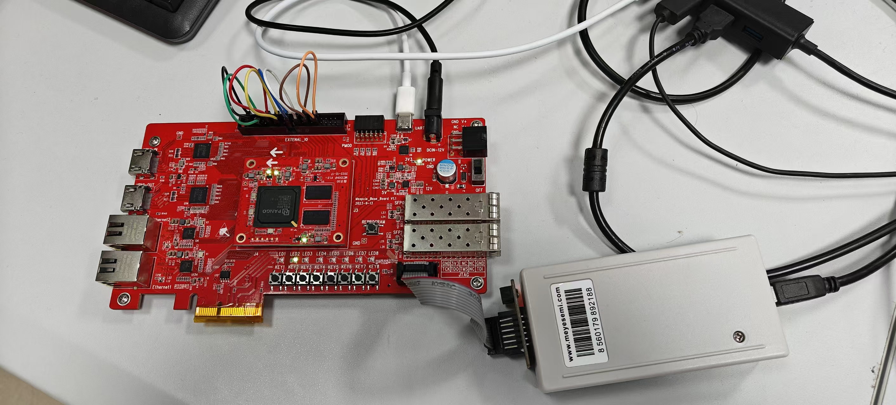

上板跑不通的东西，读代码是读不出来的。串口偶发丢帧、SPI 时序偏斜这类问题，静态测量复现不了，只能把真实波形抓下来看。商用逻辑分析仪的问题不是不好用，是通道数和协议解析方式固定，按现场需要裁剪不了。

所以这个作品的做法是：**一颗 FPGA 同时做两件事**。里面既有自己写的 RISC-V 处理器当被测对象，也有八通道逻辑分析仪当观测工具。采集源可以切到外部 J8 引脚，看板上任意数字信号；也可以切到处理器内部观测点，直接看取指、提交、停顿、冲刷发生在哪个周期——不是读性能计数器的汇总值，是逐拍看。

## 处理器

RV32I 基础整数指令集，IF / ID / EX / MEM / WB 五级流水。数据前递同时取 EX/MEM 和 MEM/WB 两级结果，Load-Use 冲突插一拍停顿，分支在解析后冲刷错误路径。

控制流加了 16 项 BTB 配 2-bit 饱和计数器，预测信息随指令流过流水线，在 EX 级复核方向和目标。RTL 仿真里这一步的效果是：

| 指标 | 关闭预测 | 开启预测 |
| --- | --- | --- |
| CoreMark 执行周期 | 1,604,264 | 1,251,724 |
| 分支冲刷次数 | 161,742 | 69,120 |
| CPI | 2.0670 | 1.5907 |

M 扩展的八条乘除指令做成并列配置，`rv32i` 和 `rv32im` 两套镜像独立构建。机器模式 CSR 与精确异常按 M-01 至 M-24 共 24 条验收条目做完，99 条独立断言全部通过。异常在退休边界接受：检测级只登记，`mepc` 和 `mtval` 由退休级给出，被冲刷的指令不产生架构副作用。

SoC 侧集成数据 RAM、UART、GPIO 和 MMIO 互连，UART 经板载 CP2102 上位机通信，115200 8N1。

## 两个被实测否掉的方案

这部分我觉得比成绩更值得写出来。

**I-Cache 和 D-Cache 功能是对的，但都被关了。** 两路组相联，接进去之后 CoreMark 执行周期分别涨到 2,891,324 和 1,348,302——比不开还慢。原因是这套设计里访存本来就不密集，cache 命中的收益抵不过额外的时序路径和状态机开销。所以按事先定好的取舍条件关闭，也不计入性能数据。

**行式突发保留了下来。** 把同一段访问的总线周期从 48 降到 30，是净收益。

## 逻辑分析仪

独立于处理器核，通过统一 MMIO 接入。8 通道采集、电平与边沿触发、触发前后采样、2048 样本 Raw 缓存；协议层做了 UART 和 SPI 解析，另有每通道的边沿数、频率、周期抖动、占空比读数。采集、触发、存储、回传全部在核外完成，换协议或加通道不动流水线源文件。

## 指标

两组数据分属两个工程，不能合并引用。

| | 整机位流（分析仪应用） | 计分位流（rv32i / rv32im） |
| --- | --- | --- |
| 工作频率 | 85.000 MHz | 85 MHz |
| 逻辑资源 | 4,995 LUT / 3,907 FF | 4,198 LUT / 3,361 FF |
| 存储与乘法器 | 6.0 DRM / 4 APM | — |
| Setup WNS | +0.577 ns | +0.250 ns |
| 估算 Fmax | 89.3841 MHz | 86.8456 MHz |
| CoreMark | — | 79.587 / 193.192 |
| CoreMark/LUT | — | 0.0190 / 0.0460 |

85 MHz 整机位流上做了五种模式各 20 次、共 100 次板级采集，全部通过。

## 开源

RTL、约束、验证脚本和上位机工具正在整理。仓库放出后，地址会补在参数表里。
